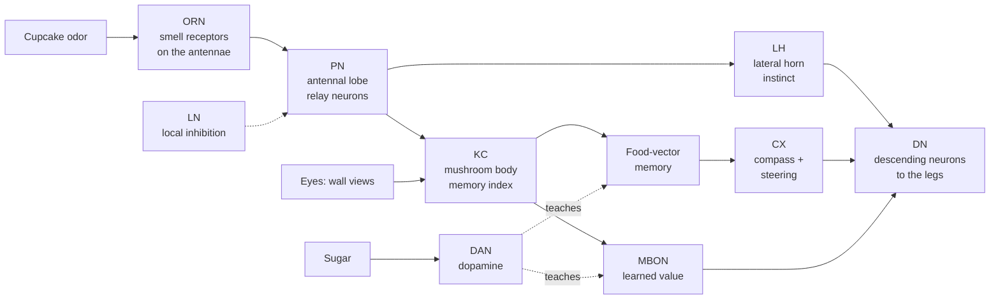

# How the Fly Finds and Learns the Cupcake

A complete, step-by-step explanation of the Fly Connectome Navigation Lab. It covers the biology, the model, the equations and what you see on screen. Every number here comes from the code in `script.js`. Where the model is a guess or a simplification, it says so.

---

## Contents

0. [The big picture](#0-the-big-picture)
1. [A short biology primer](#1-a-short-biology-primer)
2. [The arena and the fly's body](#2-the-arena-and-the-flys-body)
3. [How a model neuron works](#3-how-a-model-neuron-works)
4. [Smell: from cupcake to receptor to brain](#4-smell-from-cupcake-to-receptor-to-brain)
5. [Your questions: activation functions, gating, and which PN lights up](#5-your-questions-activation-functions-gating-and-which-pn-lights-up)
6. [Vision: knowing where you are from the walls](#6-vision-knowing-where-you-are-from-the-walls)
7. [The mushroom body: a sparse memory index](#7-the-mushroom-body-a-sparse-memory-index)
8. [Moving: how the fly first finds the cupcake](#8-moving-how-the-fly-first-finds-the-cupcake)
9. [Learning part 1: dopamine and value](#9-learning-part-1-dopamine-and-value)
10. [Learning part 2: path integration and the food-vector memory](#10-learning-part-2-path-integration-and-the-food-vector-memory)
11. [Steering with the central complex](#11-steering-with-the-central-complex)
12. [Training versus testing](#12-training-versus-testing)
13. [What you see on screen](#13-what-you-see-on-screen)
14. [The glass brain: what the lights mean](#14-the-glass-brain-what-the-lights-mean)
15. [How accurate is all this?](#15-how-accurate-is-all-this)
16. [Where each equation comes from](#16-where-each-equation-comes-from)
17. [Known issues](#17-known-issues)
18. [Glossary](#18-glossary)
19. [References](#19-references)

---

## 0. The big picture

A fly is placed in a square arena with a cupcake it cannot see. It has:

- **two antennae** to smell with,
- **eyes** that see the four walls,
- **a sense of its own movement**, which tells it how far it has walked and in which direction.

It does **not** know its position on the map, and it does **not** know where the cupcake is.

Information flows through the model brain like this:

In one sentence each:

1. **Smell:** the ORNs detect the odor, the PNs clean up the signal, and the LH provides an instinctive pull toward it.
2. **Place:** the eyes see the walls, and some Kenyon cells (KCs) become place cells, each firing in one patch of the arena.
3. **Learning:** sugar releases dopamine. Dopamine does two things:
   - it marks the recently visited places as good (value);
   - it stores, for each place, the vector to the food (memory).
4. **Steering:** wherever the fly is, its place cells recall the food vector. The central complex compares that vector with the fly's compass heading and turns the fly toward the food.

---

## 1. A short biology primer

### Neurons, spikes and firing rate

A **neuron** is a cell that sends electrical pulses called **spikes**. How often it spikes is its **firing rate**, for example 50 spikes per second. A busy neuron might fire 200 times a second. A quiet one might fire only 2–5 times a second; this is its **spontaneous** or **baseline** activity.

Neurons connect at **synapses**:

- An **excitatory** synapse makes the next neuron fire more.
- An **inhibitory** synapse makes it fire less.

### Smell in the fruit fly

Think of smell as a mail system:

| Biology | What it is | Mail analogy |
|---|---|---|
| **Odorant receptor** | A protein in the membrane of a smell neuron. It binds certain molecules. For example, the receptor **Or42b** binds fruity esters such as ethyl acetate, which is common in fermenting fruit and vinegar. | A mailbox lock that only one kind of key opens |
| **ORN** (olfactory receptor neuron) | A neuron on the antenna that carries **one** receptor type and fires when that receptor binds its odor. A fly has about 1,300 ORNs per antenna, in about 50 types. | A postman who carries only one kind of letter |
| **Glomerulus** | A small ball of tangled wiring in the antennal lobe. All ORNs of one type send their axons to the same glomerulus, so each glomerulus is effectively one odor channel. | A sorting bin for one kind of letter |
| **DM1, DM4, VA2, DA2, …** | Names of glomeruli, based on position: **D** = dorsal (top), **V** = ventral (bottom), **M** = medial (middle), **L** = lateral (side), **A** = anterior (front), **P** = posterior (back), plus a number. **DM1** is "dorsal-medial glomerulus number 1". It receives the Or42b ORNs, so it responds strongly to vinegar and fruity smells. **DA2** receives the Or56a ORNs, which detect geosmin, the smell of mould that flies avoid. | Bin labels by shelf position |
| **PN** (projection neuron) | A neuron whose input branches sit inside **one** glomerulus. It carries that glomerulus's signal to higher brain areas. Its FlyWire name tells you the glomerulus: `DM1_lPN` is a PN from DM1. | A courier who picks up from one bin and delivers across town |
| **LN** (local neuron) | An antennal-lobe neuron that connects many glomeruli, mostly by inhibition. It turns the volume down when the total smell is strong. | A manager who tells everyone to calm down when the office gets loud |
| **AL** (antennal lobe) | The brain area holding all the glomeruli, PNs and LNs. | The sorting office |
| **LH** (lateral horn) | Receives PNs and drives **instinctive** (innate) odor behaviour: approach food smells, avoid mould. It needs no learning. | Reflexes |
| **MB** (mushroom body) | The fly's learning and memory centre, with about 2,000 **Kenyon cells** per side. | A filing cabinet |
| **KC** (Kenyon cell) | Each KC samples a few random PNs and fires only when several of them are active together. Only about 5–10% of KCs fire for any one smell. | A file card that stands for one specific combination |
| **APL** | A single giant inhibitory neuron per side. It keeps KC activity sparse. | A bouncer who lets only the top few in |
| **DAN** (dopamine neuron) | Releases dopamine into the mushroom body. **PAM** DANs fire for reward such as sugar. **PPL1** DANs fire for punishment, or when an expected reward doesn't come. | A teacher saying "good!" or "no!" |
| **MBON** (mushroom body output neuron) | Reads out the KCs. Some push the fly to **approach**, others to **avoid**. | The drawer handle: what the file says to do |
| **CX** (central complex) | Navigation centre: compass, goal and steering. | Satnav |
| **EPG** | CX neurons that form a **bump** of activity pointing in the fly's current heading, like a compass needle. | Compass needle |
| **PEN** | CX neurons active during turns. They move the compass bump. | The hand that rotates the needle |
| **FC2** | CX neurons that hold a **goal direction**. | The destination arrow |
| **PFL3** | CX neurons that compare heading with goal and output "turn left" or "turn right". | "Turn left in 100 m" |
| **PFL2** | CX neurons that respond when the goal is behind the fly. | "Make a U-turn" |
| **DN** (descending neuron) | Carries commands from the brain down to the legs. **DNa02** controls turning, **DNp09** controls walking forward. | Nerves to the steering wheel and pedals |

### The FlyWire connectome

**FlyWire** reconstructed every neuron in one adult fly brain from electron microscopy: **139,248 neurons** with their shapes, positions and cell types. This project uses the real positions and cell types of 977 of them, one per model unit, and draws the other ~137,000 as the "glass" brain. It also uses their **real synapses**: 631,412 FlyWire synapses onto the model neurons, from the synapse table of the Shiu et al. 2024 whole-brain model (section 3.2).

---

## 2. The arena and the fly's body

- **Arena:** the arena is **70 × 70 units**. A unit is abstract; think of it as about a millimetre for a fly.
- **Time:** time moves in **steps**. Training runs at 75 steps per second on screen, and test runs at 50.
- **The fly:** the fly has a position $(x, y)$, a heading $h$ (the direction it faces, in radians) and a speed of about 0.34–0.6 units per step.
- **Starting position:** each trial starts at a random point on the left side, with a random heading.
- **The cupcake:** it stays put until you click to move it. The fly "finds" it when within **3.1 units**.
- **Walls:** hitting a wall bounces the fly and gives a tiny punishment of $r = -0.05$.
- **Timeout:** a trial that goes 1,500 steps without a find ends as a failure.

---

## 3. How a model neuron works

The model brain runs in **two layers at once**:

1. A **rate model** (section 3.1) turns smell, wall views and reward into firing rates, and these rates drive behaviour and learning.
2. A **spiking network** (section 3.2) of the same 977 neurons, wired with real FlyWire synapses, fires the spikes you see in the glass brain and that the data check (section 15.1) measures.

### 3.1 Rate neurons

Each rate neuron has one number:

$$
r \in [0, 1]
$$

$r$ means "fraction of maximum firing rate". $r = 0.5$ is about half of the neuron's top speed, and $r = 0.04$ is near silent.

Each step, every model neuron does the same thing:

$$
\text{inputs} \;\longrightarrow\; \text{combine (sum or average)} \;\longrightarrow\; \text{activation function} \;\longrightarrow\; r
$$

The **activation function** decides how the neuron responds to its input. The model uses a few kinds:

| Kind | Shape | Example in this model |
|---|---|---|
| **Saturating (Hill)** | Rises smoothly, then levels off. No hard threshold. | ORNs |
| **Divisive normalization** | Like saturating, but the ceiling depends on the total activity of neighbours. | PNs |
| **Threshold-linear (ReLU with threshold)** | Zero below a threshold, then rises in a straight line. This is **gated**. | LH, KCs, PFL3, DNa02 |
| **Cosine tuning** | Highest for one preferred direction and falling off either side. | EPG, FC2 |

**ReLU** (rectified linear unit) means "negative becomes zero":

$$
\operatorname{relu}(z) = \max(0, z)
$$

**clamp** keeps a number inside a range:

$$
\operatorname{clamp}(z, a, b) = \min(b, \max(a, z))
$$

### 3.2 Spiking neurons on real synapses

Every model neuron is also a **leaky integrate-and-fire** (LIF) neuron, with the membrane constants of the Shiu et al. 2024 whole-brain model:

$$
\tau_m \frac{dv}{dt} = v_0 - v + g, \qquad \tau_s \frac{dg}{dt} = -g
$$

| Constant | Value |
|---|---|
| Resting and reset potential $v_0$ | −52 mV |
| Spike threshold | −45 mV |
| Membrane time constant $\tau_m$ | 20 ms |
| Synaptic time constant $\tau_s$ | 5 ms |
| Refractory period | 2.2 ms |
| Synaptic delay | 1.8 ms |

When a neuron crosses threshold it spikes, resets to $v_0$, and 1.8 ms later every neuron it connects to gets a kick to $g$ of:

$$
\Delta g = \operatorname{clamp}\!\left(0.275\ \text{mV} \times 0.3 \times n_{\text{syn}},\ -40,\ 40\right)\ \text{mV}
$$

- $n_{\text{syn}}$ is the **signed real synapse count**: positive for acetylcholine, negative for GABA or glutamate, from the predicted neurotransmitter.
- 0.275 mV per synapse is the Shiu et al. value. The extra factor 0.3 and the 40 mV cap are model choices. One model neuron stands in for a whole cell type (below), so one model spike stands for many near-synchronous real spikes, and the cap stops a single input from being absurdly large.
- PN→KC synapses get a further ×4 ("claw gain"). PN boutons make multi-site synapses onto KC claws, which EM counts undercount. This one factor was set so an odor-driven KC fires a few spikes per encounter. **How many** KCs fire is left to the real APL feedback.
- The network runs at 0.5 ms resolution, 20 ms of neural time per behavioural step.

**Where the synapses come from.** `tools/build_connectome_wiring.py` reads the FlyWire v783 synapse table. Most model populations are a sample of a real cell type (4 of ~50 DM1 ORNs, 200 of ~2,000 KCs), so each model neuron stands in for **all real neurons of its cell type and side**. ORNs and PNs are typed by glomerulus. The real synapses from each presynaptic type are split across that type's model neurons: in proportion to their own direct synapses where they have some, evenly where none connects directly. That gives 34,833 model connections standing for **631,412 real synapses**, of which 126,387 are direct synapses between the 977 sampled neurons.

**Which neurons are simulated and which are driven.** Some populations get their input from things the model doesn't contain as neurons: the odor itself, the visual system, the reward, the fly's heading. Those fire as random (Poisson) spike trains at their model rate times a ceiling:

| Driven population | Ceiling |
|---|---|
| ORNs (odor) | 200 Hz |
| Visual KCs (wall views; their visual input neurons are not modelled) | 30 Hz |
| PAM, PPL1 (reward prediction error) | 40 Hz |
| EPG (heading), PEN (turning), FC2 (goal) | 60, 40, 40 Hz |
| Any neuron whose real input comes mostly (> 50%) from cell types not in the model, such as PFL3 and the descending neurons | 60 Hz |

**Everything else fires only through its real synapses**: 34 of 64 PNs, the LNs, LH neurons, 198 of 200 olfactory KCs, APL, and the MBONs. Measured rates while smelling the plume: ORN ~31 Hz, PN ~33 Hz, olfactory KCs ~4 Hz on average (about 7% of them responding, and 0.1 Hz with no odor), APL ~150 Hz, MBONs 18–21 Hz.

**Learning reaches the spikes.** Each KC→MBON synapse is multiplied by that KC's current learned weight $w^{\text{ap}}_k$ or $w^{\text{av}}_k$ (section 9), so the MBON spike rates change with training.

---

## 4. Smell: from cupcake to receptor to brain

### 4.1 The odor in the air

The cupcake gives off odor in **puffs**, carried by a wind that blows from right to left, toward where the fly starts. This is a simple filament model of a turbulent plume (Farrell et al. 2002):

- Each step (20 ms), a new puff leaves the cupcake with probability 0.6.
- Every puff moves 1.6 units per step along the wind, plus random jitter, and its spread $r_p^2$ grows by 0.35 per step from 0.3.
- The wind direction meanders up to ±0.6 rad around "leftward", as a slowly drifting random walk, so the plume snakes.

The odor at a point is the sum of the puffs:

$$
c(x, y) = \min\!\left(1,\ \sum_p \frac{1.1}{r_p^2}\, \exp\!\left(-\frac{d_p^2}{2 r_p^2}\right)\right)
$$

where $d_p$ is the distance to puff $p$. Near the cupcake the puffs are small and dense, so the odor is strong and nearly continuous. Downwind they are larger, fainter and farther apart, so the fly meets **brief, patchy encounters with gaps in between**, as real flies do.

**The average plume.** Averaged over time, the puffs make a smooth hill, strongest **at** the cupcake and trailing farther downwind than upwind. The gradient field arrows (section 13) and the data check's place probes use this average:

$$
o(x, y) = 0.8 \cdot \exp\!\left(-\sqrt{\left(\frac{\Delta x}{\lambda_x}\right)^2 + \left(\frac{\Delta y}{12}\right)^2}\right), \qquad \lambda_x = \begin{cases} 13 & \text{downwind (left of the cake)} \\ 9 & \text{upwind (right of the cake)} \end{cases}
$$

where $\Delta x = x - x_{\text{cake}}$ and $\Delta y = y - y_{\text{cake}}$.

**Example of the average plume** (along the line through the cupcake):

| Where | Odor $o$ |
|---|---|
| At the cupcake | 0.80 |
| 3 units downwind | 0.64 |
| 10 units downwind | 0.37 |
| 20 units downwind | 0.17 |
| 30 units downwind | 0.08 |
| 40 units downwind | 0.04 (almost nothing) |
| 10 units crosswind (above or below) | 0.35 |
| 10 units upwind | 0.26 |

The fly usually starts 25–50 units away, at the faint edge of the plume or outside it.

Why this shape? It has a **sharp peak** at the cupcake, so the **relative** difference between two nearby points stays about the same all the way in. That keeps the left/right comparison between the antennae useful even right next to the cupcake.

*Fix history:* an earlier version multiplied a round Gaussian by a "wind" factor. By mistake, that put the strongest smell **10 units to the left of the cupcake**, not at it, so a fly following its nose ended up beside the cupcake instead of on it. A later version used the smooth hill as the odor itself; the fly now smells the puffs.

*Simplification:* the puffs are blobs, not the thin, stretched filaments of real turbulence, and the wind is two-dimensional and uniform across the arena.

### 4.2 Two antennae

The fly samples the odor at two points, **0.9 units ahead** of its body and **0.6 units to each side**. That gives $o_L$ (left antenna) and $o_R$ (right antenna). Because the antennae are close together, the difference is small. **Example** (in the average plume): 10 units from the cupcake, facing so the cupcake is to the right, $o_L = 0.329$ and $o_R = 0.363$, about a 10% difference.

### 4.3 ORNs: receptor neurons

Each model ORN belongs to one glomerulus $g$ and one antenna. It responds to the odor at its own antenna:

$$
r_{\text{ORN}} = 0.03 + D_g \cdot \frac{o^{1.5}}{o^{1.5} + 0.09} + \text{noise}(0 \ldots 0.02)
$$

- $0.03$ is **spontaneous firing**: even with no odor, ORNs fire a little.
- $D_g$ is how strongly glomerulus $g$ responds to the cupcake smell:

| Glomerulus | DM1 | DM4 | DP1m | VA2 | DM2 | DM3 | DM5 | VM7d | DL1 | VA3 | the other 22 (e.g. DA2) |
|---|---|---|---|---|---|---|---|---|---|---|---|
| $D_g$ | 1.0 | 0.95 | 0.85 | 0.8 | 0.75 | 0.6 | 0.5 | 0.45 | 0.35 | 0.3 | 0 |

- The fraction $\frac{o^{1.5}}{o^{1.5}+0.09}$ is a **Hill function**, the standard shape of a receptor dose-response curve. It is near 0 for faint odor, rises steeply, then saturates near 1.

**Worked example** (from the model):

| Odor at antenna | DM1 ORN ($D = 1$) | VA3 ORN ($D = 0.3$) | DA2 ORN ($D = 0$) |
|---|---|---|---|
| 0 (far away) | 0.04 | 0.04 | 0.04 |
| 0.05 (edge of plume) | 0.15 | 0.07 | 0.04 |
| 0.32 (close) | 0.71 | 0.24 | 0.04 |

DA2 never responds, because the cupcake doesn't smell of mould.

*Biology check:* receptor neurons really do have a spontaneous rate and a saturating dose-response. The $D_g$ table is an **approximation** of which glomeruli respond to fermenting fruit and vinegar. It is not taken from measured receptor databases such as DoOR or Hallem & Carlson 2006.

### 4.4 PNs and LNs: the antennal lobe

**Step 1, collect.** Each PN averages the model ORNs that synapse onto it, weighted by their **real FlyWire synapse counts** $n_i$ (section 3.2). These are almost all ORNs of its own glomerulus, from **both** antennae: most ORNs send axons to both antennal lobes. Real ORNs also release about 40% more transmitter onto the PN on their own side (Gaudry et al. 2013), which synapse counts don't show, so same-side synapses are weighted ×1.4:

$$
x_{\text{PN}} = 1.4 \times \frac{\sum_i w_i \, r_{\text{ORN},i}}{\sum_i w_i}, \qquad w_i = n_i \times \begin{cases} 1.4 & \text{same side} \\ 1 & \text{other side} \end{cases}
$$

In the real counts, same-side ORN synapses already outnumber opposite-side ones by about 1.23 to 1, so the combined same-side advantage is about 1.7 to 1. (If the wiring file fails to load, the model falls back to weights 0.7 and 0.3.)

**Step 2, LN inhibition.** The LNs measure the **average** PN input across all glomeruli:

$$
\text{LN} = \operatorname{clamp}\!\left(3 \times \overline{x_{\text{PN}}},\ 0,\ 1\right)
$$

**Step 3, divisive normalization.** Each PN's output is divided by a term that grows with its own input and with LN activity:

$$
r_{\text{PN}} = \operatorname{clamp}\!\left(1.6 \times \frac{x_{\text{PN}}}{x_{\text{PN}} + 0.35 + 0.35 \cdot \text{LN}},\ 0,\ 1\right)
$$

In simple words: a PN amplifies weak signals and compresses strong ones. When the whole antennal lobe is busy, LN inhibition turns every PN down a bit. This is the gain control Olsen, Bhandawat & Wilson described in 2010. It helps the fly compare smells whether they are faint or strong.

**Worked example** (from the model):

| Odor | DM1 PN | VA3 PN | DA2 PN | LN |
|---|---|---|---|---|
| 0 | 0.19 | 0.19 | 0.19 | 0.18 |
| 0.05 | 0.52 | 0.30 | 0.18 | 0.28 |
| 0.32 | 0.99 | 0.57 | 0.14 | 0.74 |

Notice that the **DA2 PN goes down** as odor rises. It gets no odor input, but the LNs are inhibiting everyone more. Real PNs show this kind of lateral inhibition.

### 4.5 LH: the instinct to approach (smell steering)

This pathway turns the fly toward the side that smells more. It works from the very first trial, with no learning. It has four parts.

**Step 1, compare left and right, glomerulus by glomerulus.** For each cupcake-responsive glomerulus $g$, take its left PN input $a_{g,L}$ and right PN input $a_{g,R}$ (the collected ORN input from section 4.4, minus the spontaneous baseline). This happens **before** the PN gain control, so nothing has saturated yet. Then:

$$
\Lambda_{\text{raw}} = \frac{\sum_g D_g\,(a_{g,R} - a_{g,L})}{\sum_g D_g\,(a_{g,R} + a_{g,L})}
$$

$\Lambda$ (lambda) is the **lateral contrast**: positive if the right side smells more, negative if the left does. Pairing the left and right PN **of the same glomerulus** keeps the comparison balanced. In real flies, ORNs release more neurotransmitter onto the PN on their own side, so each PN "knows" which antenna smells more. This is how flies turn toward odor within a few hundred milliseconds (Gaudry et al. 2013).

**Step 2, smell strength.** How far up their dose-response curve are the receptors? Read it from the ORNs as a weighted estimate of the Hill value $H$, then rescale to 0–1:

$$
\hat H = \frac{\sum D_g\,(r_{\text{ORN}} - 0.04)}{\sum D_g^2}, \qquad S = \operatorname{clamp}\!\left(\frac{\hat H - 0.08}{0.7},\ 0,\ 1\right)
$$

$S = 0$ means "smell nothing" (far away) and $S = 1$ means "smell strongly" (near the cupcake).

**Step 3, receptor gain control.** Close to the cupcake the receptors near saturation, and they barely notice a small difference; their sensitivity drops by about $1.5(1 - H)$. Real ORNs adapt so that they keep responding to **relative** changes, known as Weber's law (Gorur-Shandilya et al. 2017). The model divides that loss back out:

$$
\Lambda = \frac{\Lambda_{\text{raw}}}{1.5\,(1 - \hat H) + 0.15}
$$

**Step 4, the turn.**

$$
\text{turn}_{\text{smell}} = 0.45 \cdot S \cdot \tanh\!\left(\frac{\Lambda}{0.02}\right) \cdot \left(1 + 0.6\,V^{+}\right)
$$

- $S$ makes the turn **grow as the fly gets closer**.
- $\tanh$ makes the response graded for small differences, and saturates it at "turn as hard as smell allows" for big ones.
- $V^+$ is the learned value (section 9), if positive. After learning, the smell pull gets up to 60% stronger.
- A positive turn means turn right.

**The LH neurons** display this innate drive. Each LH neuron's rate is the synapse-weighted average of its **real PN inputs**, times $1.4\,(0.6 \pm 0.4\tanh(\Lambda/0.02))$, so the side that smells more is brighter. In the spiking network (section 3.2) the LH neurons are driven by their real PN synapses alone.

**Worked example** (from the model), with the cupcake to the fly's right:

| | 10 units away | 30 units away |
|---|---|---|
| Odor at left / right antenna | 0.329 / 0.363 | 0.062 / 0.069 |
| Smell strength $S$ | 0.88 | 0.11 |
| Lateral contrast $\Lambda$ | 0.015 | 0.018 |
| $\tanh(\Lambda / 0.02)$ | 0.63 | 0.71 |
| **Smell turn** (toward the cupcake) | **0.25 rad** (about 14°) | **0.035 rad** (about 2°) |
| Random turning size (training, section 8) | 0.07 | 0.18 |

Both flies know the cupcake is to their right; the contrast is similar. But the near fly is **sure** ($S = 0.88$) and turns hard, while the far fly barely smells anything ($S = 0.11$), so randomness still dominates. (These numbers are for the average plume. In the puffs, the near fly gets them almost every step; the far fly only during an encounter.)

### 4.6 Odor ON and OFF: running upwind and casting

In a patchy plume, comparing the antennae only works during an encounter. Between puffs, real walking flies use a second strategy: when odor arrives they turn **upwind** and speed up, and when it is lost they slow down, turn more and drift back (Álvarez-Salvado et al. 2018). Upwind turning needs the antennae's wind sense, which reaches the fan-shaped body of the central complex (Matheson et al. 2022).

The model keeps two signals:

$$
\text{ON}_t = \begin{cases} \text{ON}_{t-1} + 0.6\,(S_t - \text{ON}_{t-1}) & \text{if } S_t > \text{ON}_{t-1} \\ 0.96\ \text{ON}_{t-1} & \text{otherwise} \end{cases}
$$

$$
\text{peak}_t = \max(\text{ON}_t,\ 0.985\ \text{peak}_{t-1}), \qquad \text{OFF}_t = \operatorname{relu}(\text{peak}_t - \text{ON}_t)
$$

- **ON** follows smell strength up quickly and fades over about half a second.
- **OFF** is how far ON has fallen from its recent peak, so it is largest just after the fly loses the odor.

They act in three places:

| Signal | Effect | Section |
|---|---|---|
| ON | adds an upwind goal of strength $0.8\,\text{ON}$ to the central complex | 11.2 |
| OFF | adds a weaker **downwind** goal, $-0.5\,\text{OFF}$, so a fly that overshot drifts back into the plume | 11.2 |
| ON, OFF | random turning shrinks with ON and widens up to 3.5× with OFF (casting); speed rises with ON and falls with OFF | 8.1, 8.3 |

---

## 5. Your questions: activation functions, gating, and which PN lights up

### "Are ORN, PN and LN activation functions?"

Each of them **has** an activation function. That is the rule turning its input into a firing rate:

| Neuron | Input | Activation function | Gated (hard threshold)? |
|---|---|---|---|
| **ORN** | odor at its antenna | Hill: $0.03 + D_g \frac{o^{1.5}}{o^{1.5}+0.09}$ | **No.** Always fires at least 0.03, and rises smoothly |
| **PN** | synapse-weighted average of its ORNs (almost all from its own glomerulus) | divisive normalization: $1.6\frac{x}{x + 0.35 + 0.35\,\text{LN}}$ | **No.** Always fires (baseline about 0.19) |
| **LN** | average of all PN inputs | linear, then clamped: $\min(1, 3\bar x)$ | **No** |
| **LH** | its real PN inputs and left/right contrast $\Lambda$ | $1.4\,\bar r_{\text{PN}}\,(0.6 \pm 0.4\tanh(\Lambda/0.02))$ | **No.** It follows its PNs; the smell **turn** is soft-gated by $S$ (section 4.5) |
| **KC** | its real PN claws, or 2 wall channels | threshold set by APL (only the top $k$ fire) | **Yes.** Adaptive threshold |
| **DAN** | reward and prediction error | $0.08 + 3\,\operatorname{relu}(\pm\delta) + \ldots$ | Rectified: PAM for positive, PPL1 for negative |
| **MBON** | KC outputs times synapse weights | linear sum | No |
| **EPG** | heading | $\operatorname{relu}(\cos(\theta - h))^2$ | Rectified tuning curve |
| **PFL3** | heading and goal | $\lvert G\rvert \cdot \operatorname{relu}(\pm\sin(\text{error}))$ | Rectified |
| **DNa02** | turn command | $0.06 + 2.2\,\operatorname{relu}(\pm\text{turn})$ | Rectified |

So PNs are **not** switched on by crossing a threshold. They are always on, and their rate goes up and down smoothly with the odor. The first gate in the smell pathway is the **KCs**, whose threshold is set by APL. The LH smell turn is also soft-gated: it stays zero until the smell strength $S$ rises above 0.

### "PNs have multiple neurons. Which one lights up, and how do you know?"

The **glomerulus** decides, and the connectome tells us which glomerulus each PN belongs to.

1. **In the model:** there are 32 glomeruli, each with 2 PNs, one per side, so 64 PNs. A PN's input comes from the real ORN synapses onto it, which are almost all from ORNs of its own glomerulus. The wiring tool keys both by glomerulus: the FlyWire cell type `DM1_lPN` is parsed as glomerulus DM1, and `ORN_DM1` likewise. So:
   - **The 20 PNs of the 10 cupcake glomeruli light up**, most strongly DM1 and DM4, because their $D_g$ is largest.
   - **The PNs of the other 22 glomeruli stay near baseline** (about 0.19) and even dip slightly as LN inhibition grows.
   - **Left and right PNs of the same glomerulus both light up**, because ORNs feed both sides. The PN on the side of the stronger antenna is a little higher, for example 0.99 versus 0.98 in the table above.
2. **In biology, how we know:** three kinds of evidence.
   - **Receptor maps:** each ORN type expresses one receptor and sends axons to one glomerulus, for example Or42b to DM1 (Couto et al. 2005; Fishilevich & Vosshall 2005).
   - **Odor responses:** recordings of each receptor against hundreds of odors tell us which glomeruli a smell activates (Hallem & Carlson 2006; the DoOR database).
   - **Anatomy:** a uniglomerular PN has its input branches in one glomerulus. FlyWire annotators named each PN by where its dendrites are, which is where `DM1_lPN` comes from.
3. **What you see:** in the glass brain, a PN flashes when it spikes (section 14), driven by its real ORN synapses. So DM1 and DM4 PNs flicker brightly in the plume, while PNs from DA2 and other unrelated glomeruli flicker only at their baseline. All model neurons of one type and side get the same rate, apart from a little noise. Real neurons of the same type vary more.

### "And which Kenyon cell lights up?"

Each olfactory KC gets its **real PN inputs** from FlyWire: the synapses its cell type receives from each glomerulus's PNs (section 7.1). The 10 KCs with the highest total input win, but only if that input passes 0.32 (section 7). So which KCs light up for the cupcake follows from the real claws, although each model KC averages over the real KCs of its type and side, so it is less specific than any single real KC. In the spiking network, how many fire is set by the real APL feedback, and comes out at about 7%. That matches Caron et al. 2013, Lin et al. 2014 and Honegger et al. 2011.

---

## 6. Vision: knowing where you are from the walls

The fly sees the four walls. A near wall looks tall and a far wall looks short. The **apparent height** (elevation angle) of a wall at distance $d$ is:

$$
e = \arctan\!\left(\frac{20}{d}\right)
$$

**Example:** a wall 5 units away looks $e \approx 1.33$ rad tall, and one 60 units away looks $e \approx 0.32$ rad.

Each wall is seen by **12 tuned channels**. Channel $i$ prefers height $\mu_i$, spaced evenly from 0.28 to 1.40, and responds like a bell curve:

$$
c_i = \exp\!\left(-\frac{(e - \mu_i)^2}{2 \cdot 0.07^2}\right)
$$

That gives 48 channels in total. This is a stand-in for the fly's visual projection neurons. Real flies do see panoramas with landmarks. Here the walls themselves are the landmarks.

---

## 7. The mushroom body: a sparse memory index

### 7.1 Olfactory KCs (smell)

Each olfactory KC sums its real PN claws:

$$
u_k = \frac{1}{6}\sum_{j} w_{kj}\, r_{\text{PN},j}, \qquad w_{kj} = \frac{6\, n_{kj}}{\overline{\sum_j n_{kj}}}
$$

$n_{kj}$ is the real synapse count from PN $j$'s glomerulus onto KC $k$'s type (section 3.2). The weights are scaled so the **average** KC's weights sum to 6, matching the older random-claw version, which picked 6 PNs with weights 0.7–1.3 and is still the fallback without the wiring file.

### 7.2 Visual KCs (place)

Each visual KC is a **coincidence detector** for one east/west-wall channel and one north/south-wall channel:

$$
u_k = \sqrt{w_1 c_{\text{E/W}} \cdot w_2 c_{\text{N/S}}}
$$

Because it multiplies, $u_k$ is high **only** where both wall views match, at one patch of the arena. That makes it a **place cell**.

**Example:** a KC that likes "west wall looks medium" and "north wall looks tall" fires near the top of the arena, about a third of the way across. Everywhere else, at least one factor is near zero.

This is how the model's "place cells" emerge. Nothing tells a KC its coordinates. It only combines two views.

### 7.3 APL: only the top few may fire

APL inhibition sets an adaptive threshold $\theta$: the $(k+1)$-th largest input, or a fixed floor, whichever is higher. Then:

$$
\text{KC}_k = \frac{\operatorname{relu}(u_k - \theta)}{\max\!\left(\sum_j \operatorname{relu}(u_j - \theta),\ 0.2\right)}
$$

| Pool | Cells | Allowed to fire | Floor |
|---|---|---|---|
| Olfactory KCs | 200 | top 10 (5%) | 0.32 |
| Visual KCs | 140 | top 7 (5%) | 0.02 |

The division makes the active KCs share a total of about 1. That keeps later learning stable.

This top-$k$ rule is the **rate model's** stand-in for APL. In the spiking network, APL is a real neuron driven by its real KC synapses, and its real GABA synapses back onto the KCs keep them sparse on their own.

**Example** (rate model): with no odor, **0** olfactory KCs fire. At odor 0.05, **10** fire, and a different 10 fire at 0.32. The visual KCs always have about 7 firing, and which 7 depends on where the fly is.

---

## 8. Moving: how the fly first finds the cupcake

Before any learning there is no memory and no value, so $G = 0$ and $V = 0$. The fly has two things: random search and smell. **How much each one steers depends on how close the fly is to the cupcake.**

### 8.1 A random walk with momentum

$$
\tau_t = 0.72\,\tau_{t-1} + \sigma\,\xi_t, \qquad \xi_t \sim \mathcal{N}(0, 1)
$$

In words: each step, the fly's turn is 72% of its last turn plus a random nudge. This gives smooth, wandering paths rather than jitter.

The size of the random nudge is:

$$
\sigma = \sigma_0 \cdot \underbrace{(1 - 0.65\,C)}_{\text{memory confidence}} \cdot \underbrace{(1 - 0.75\,\text{ON})}_{\text{smelling}} \cdot \underbrace{(1 + 2.5\,\text{OFF})}_{\text{casting}}
$$

- $\sigma_0 = 0.20$ in training and $0.09$ in test.
- $C$ is memory confidence (section 11). A confident fly wanders less.
- ON is the odor-on signal (section 4.6), which follows smell strength $S$. **While the fly smells the cupcake, it wanders up to 75% less**, and the closer it is, the more steadily it smells.
- OFF is the odor-off signal (section 4.6). **Casting:** just after losing the odor, the fly zig-zags up to 3.5 times wider, as real flies do when they lose a plume (Álvarez-Salvado et al. 2018).

### 8.2 The smell pull

This is $\text{turn}_{\text{smell}}$ from section 4.5. It grows with smell strength $S$, while the random term shrinks with ON, which follows $S$. Together they give a smooth hand-off from searching to homing in. In the average plume, with ON $= S$:

| Distance from cupcake (downwind) | Smell strength $S$ | Smell turn | Random turning size (training) | Who steers? |
|---|---|---|---|---|
| 40 units | 0.00 | 0.00 | 0.20 | random only |
| 30 units | 0.17 | 0.05 | 0.17 | mostly random |
| 20 units | 0.52 | 0.15 | 0.12 | about equal |
| 15 units | 0.72 | 0.20 | 0.09 | smell, 2× |
| 10 units | 0.91 | 0.24 | 0.06 | smell, 4× |
| 3 units | 1.00 | 0.22 | 0.05 | smell, 4× |

Crosswind and upwind approaches behave the same way. The smell turn there is 0.14–0.32 rad within 15 units. In the puffs, these turns come in bursts during encounters, and the upwind goal (section 11.2) carries the fly between them.

### 8.3 Putting it together

$$
h_{t+1} = h_t + \operatorname{clamp}\!\left(\tau_t + \text{turn}_{\text{smell}} + \text{turn}_{\text{memory}},\ -0.55,\ 0.55\right)
$$

$$
\text{speed} = \left(0.34 + 0.2\,V^{+} + 0.15\,\text{ON}\right)\left(1 - 0.35\,\text{OFF}\right) \qquad (\times 0.6 \text{ when the goal is behind; see section 11})
$$

$\text{turn}_{\text{memory}}$ steers toward the central-complex goal, which includes the upwind and downwind terms from section 4.6.

The fly then steps forward: $x \mathrel{+}= \text{speed}\cdot\cos h$ and $y \mathrel{+}= \text{speed}\cdot\sin h$.

**So how does it find the cupcake the first time?** In two phases:

1. **Search:** far away, the fly meets only rare, faint puffs, so it mostly wanders randomly. Momentum keeps the path smooth. Each whiff turns it upwind for a moment, and casting widens the search when the whiff is lost.
2. **Home in:** once it is within about 20 units, encounters come often. Random turning shrinks, the fly runs upwind and faster, and the turn toward the stronger antenna grows. The fly curves in and reaches the cupcake.

An untrained fly finds it in a median of **about 200–480 steps** in the benchmark (section 12).

---

## 9. Learning part 1: dopamine and value

### 9.1 Value: "how good is it here?"

Each KC connects to the **approach** MBONs and to the **avoid** MBONs. Two numbers describe each pathway:

- $a_k$ and $b_k$: how many **real synapses** KC $k$'s type makes onto approach and onto avoid MBONs in FlyWire, relative to the average KC of its pool (olfactory or visual), capped at 2.5. They are fixed.
- $w^{\text{ap}}_k$ and $w^{\text{av}}_k$: the **learned strength** of those synapses. Both start at 1, and dopamine changes them (section 9.4).

The fly's sense of how good its current situation is, is approach minus avoid output, measured from the naive fly:

$$
V = \sum_k \widetilde{\text{KC}}_k \left(a_k w^{\text{ap}}_k - b_k w^{\text{av}}_k\right) \;-\; \sum_k \widetilde{\text{KC}}_k \left(a_k - b_k\right)
$$

- The second sum is what the same KCs would give before any learning, so at the start $V = 0$ everywhere, even though real KCs don't connect equally to both pathways.
- $\widetilde{\text{KC}}_k$ is the KC output smoothed over time, closing 20% of the gap each step: MBONs integrate their KC input over about 100 ms, which smooths the puff-by-puff flicker of the olfactory KCs.
- Because $a_k$ and $b_k$ are real, a KC with few synapses onto a pathway can change that pathway only a little.

### 9.2 The dopamine signal: surprise

Dopamine reports a **reward prediction error**, meaning what you got minus what you expected:

$$
\delta_t = r_t + 0.985\, V_t - V_{t-1}
$$

- $r_t = 1$ at the sugar, $-0.05$ at a wall, and $0$ otherwise.
- $0.985$ is the **discount**: rewards soon count more than rewards later.

**Example:**
- **First find:** the fly didn't expect anything, so $V_{t-1} \approx 0$ and $\delta = 1 - 0 = 1$. Big dopamine burst.
- **After training:** the fly partly expects the reward as it arrives, so $\delta$ is smaller. In the benchmark, the average burst at sugar fell from 0.69–0.92 over the first trials to 0.31–0.42 over the last ones, about half. The live data check's medians show a 21–78% drop.
- **Earlier on the path:** walking toward the cupcake, $V$ rises from step to step, so small positive $\delta$ values appear **before** the sugar. The dopamine response has moved earlier.

The model's dopamine neurons read this signal:

$$
\text{PAM} = 0.08 + 3\,\operatorname{relu}(\delta) + 0.6\,r, \qquad \text{PPL1} = 0.08 + 3\,\operatorname{relu}(-\delta) + \operatorname{relu}(-r)
$$

### 9.3 Which synapses change: the eligibility trace

Each KC keeps a fading memory of how recently it fired:

$$
e_k \leftarrow 0.985 \times 0.9 \times e_k + \text{KC}_k
$$

It halves in about 6 steps. This answers the question "who was active just before the surprise?"

### 9.4 The learning rule (dopamine weakens synapses)

With $\Delta_k = 0.15\,\lvert\delta\rvert\, e_k$ and $\delta$ clamped to $[-1, 1]$:

$$
\delta > 0 \text{ (PAM):}\quad w^{\text{av}}_k \leftarrow w^{\text{av}}_k - \Delta_k, \qquad w^{\text{ap}}_k \leftarrow \min(1,\ w^{\text{ap}}_k + \Delta_k)
$$

$$
\delta < 0 \text{ (PPL1):}\quad w^{\text{ap}}_k \leftarrow w^{\text{ap}}_k - \Delta_k, \qquad w^{\text{av}}_k \leftarrow \min(1,\ w^{\text{av}}_k + \Delta_k)
$$

- The first part of each rule is the depression dopamine causes in its own compartment.
- The second part lets a depressed synapse in the **opposite** compartment recover toward its naive strength. Without it, noisy errors of both signs would slowly wear both pathways down to nothing. This is a model choice.
- Both weights also recover slowly together: each is lifted by $0.002\,(1 - \min(w^{\text{ap}}_k, w^{\text{av}}_k))$, scaled by the **other** pathway's synapse count, so that $V$ doesn't change. This keeps room for new learning without changing what has been learned.

The learned weights also scale the real KC→MBON synapses in the spiking network, so the MBON spike rates change too.

In simple words: after sugar, the recently active KCs lose their grip on the "avoid" output. Those places and smells now read as good. This matches the direction found in real flies: dopamine **weakens** KC-to-MBON synapses (Hige et al. 2015).

**What value does:** it makes the fly walk faster ($+0.2\,V^+$) and strengthens the smell pull. It does **not** choose a direction. That is the memory's job.

---

## 10. Learning part 2: path integration and the food-vector memory

### 10.1 Path integration: counting your own steps

The fly adds up every step it takes, with a small heading error of $0.03$ rad per step:

$$
\mathbf{p}_t = \sum_{s \le t} \text{step}_s
$$

$\mathbf{p}$ is the fly's own estimate of "where I am relative to where I started this trial". It is **not** the true map position; it drifts slightly. Real flies do this: after finding food, they can walk away and come back using only self-motion (Kim & Dickinson 2017; Corfas et al. 2019).

**Example:** the fly starts at $\mathbf{p} = (0, 0)$, walks 10 steps east and 5 steps north. Now $\mathbf{p} \approx (10\cdot\text{speed},\ -5\cdot\text{speed})$, since screen $y$ points down.

### 10.2 Where did each place cell fire?

Each visual KC keeps a running average of the path-integrated position where it fired this trial:

$$
W_k \leftarrow 0.999\,W_k + \text{KC}_k, \qquad \mathbf{P}_k \leftarrow 0.999\,\mathbf{P}_k + \text{KC}_k\,\mathbf{p}_t, \qquad \text{place}_k = \frac{\mathbf{P}_k}{W_k}
$$

### 10.3 At the sugar: write the vector (dopamine-gated)

When the fly reaches the cupcake at $\mathbf{p}_{\text{food}}$, the dopamine burst stores, for every visual KC that fired during the trial, the vector from its place to the food:

$$
\mathbf{v}_k \leftarrow \mathbf{v}_k + a_k\left[(\mathbf{p}_{\text{food}} - \text{place}_k) - \mathbf{v}_k\right]
$$

$$
c_k \leftarrow c_k + a_k (1 - c_k), \qquad a_k = 0.5\,\min(1, W_k)
$$

$c_k$ is the **certainty** (0 = no idea, 1 = sure).

**Worked example:** KC #57 fired around $\text{place} = (10, 30)$, and the food was found at $(40, 25)$. The true vector is $(30, -5)$.

| After find | $\mathbf{v}_{57}$ | $c_{57}$ |
|---|---|---|
| start | (0, 0) | 0 |
| 1st | (15, −2.5) | 0.5 |
| 2nd | (22.5, −3.75) | 0.75 |
| 3rd | (26.3, −4.4) | 0.875 |

A few finds are enough for a good memory.

Why only **visual** KCs? Olfactory KCs fire across the whole plume, so they don't carry place information. They take part in value learning (section 9) but not in the vector memory.

### 10.4 Recall: "from here, the food is that way"

Wherever the fly is, the currently active visual KCs vote:

$$
\mathbf{G} = \sum_{k \in \text{visual}} \text{KC}_k\; c_k\; \frac{\mathbf{v}_k}{\lvert\mathbf{v}_k\rvert + 4}
$$

- The direction of $\mathbf{G}$ is the **goal direction**.
- Its length $\lvert\mathbf{G}\rvert$ is **confidence**.
- The $+4$ makes $\mathbf{G}$ shrink close to the food, so smell takes over for the last few steps.

### 10.5 Forgetting, so a moved cupcake can be relearned

- **Arriving at nothing:** if memory says the food is within 3 units and there's no sugar, each active KC's certainty drops by up to 8% per step, and **all** certainties drop by 0.8% per step. This corresponds to a PPL1 omission signal.
- **Timeout:** a failed trial multiplies all certainties by 0.6.

**Example:** you click to move the cupcake. The fly walks to the old spot, finds nothing, and the old memory fades within a trial or two. It searches, finds the new spot, and writes new vectors. In the benchmark it relearned within 5–10 trials.

---

## 11. Steering with the central complex

### 11.1 The compass (EPG)

16 heading wedges, each with preferred direction $\theta_b$. Each EPG neuron fires as:

$$
r_{\text{EPG}} = \operatorname{relu}\!\left(\cos(\theta_b - h)\right)^2
$$

This makes a bump of activity centred on the current heading, as seen in real flies (Seelig & Jayaraman 2015).

### 11.2 The goal (FC2)

The goal combines the recalled food vector (section 10.4) with the wind terms from section 4.6:

$$
\mathbf{G} = \mathbf{G}_{\text{memory}} + \left(0.8\,\text{ON} - 0.5\,\text{OFF}\right)\hat{\mathbf{u}}
$$

where $\hat{\mathbf{u}}$ points upwind. While smelling, the goal tilts upwind; just after losing the odor, it tilts back downwind. This is the odor-gated wind pathway that reaches the fan-shaped body (Matheson et al. 2022).

$$
r_{\text{FC2}} = 1.4\,\min(\lvert\mathbf{G}\rvert, 1.2)\;\operatorname{relu}\!\left(\cos(\theta_b - \varphi_G)\right), \qquad \varphi_G = \text{angle of } \mathbf{G}
$$

### 11.3 The steering signal (PFL3, with a PFL2-like term)

The **heading error** is $\epsilon = \varphi_G - h$, the angle between where the fly faces and where the goal is:

$$
\text{turn}_{\text{memory}} = 0.45 \cdot \min(\lvert\mathbf{G}\rvert, 1.2) \cdot s(\epsilon)
$$

$$
s(\epsilon) = \begin{cases} \sin\epsilon & \text{if the goal is ahead } (\cos\epsilon \ge 0) \\ \pm\max(\lvert\sin\epsilon\rvert,\ 0.9) & \text{if the goal is behind (keep turning the same way)} \end{cases}
$$

When the goal is behind, the fly also slows to 60% speed. That is the PFL2-like "turn around" behaviour.

**Why the "behind" case matters:** $\sin\epsilon$ is zero both when the goal is straight ahead **and** when it is straight behind. Without the second case, a fly facing exactly the wrong way would feel no turn at all. An earlier version had this bug, and flies sometimes walked against the arrows for about 100 steps.

**Worked example:** the fly faces east ($h = 0$), the goal is at 60° ($\varphi = 1.05$ rad) and $\lvert\mathbf{G}\rvert = 1$:

$$
\text{turn} = 0.45 \times 1 \times \sin(1.05) \approx 0.39 \text{ rad} \approx 22^\circ \text{ this step}
$$

It turns about 22° toward the goal. Next step the error is smaller, so it turns less, and after a few steps it is on course.

The display neurons use:

$$
r_{\text{PFL3,R}} = \lvert\mathbf{G}\rvert\operatorname{relu}(\sin\epsilon), \quad r_{\text{PFL3,L}} = \lvert\mathbf{G}\rvert\operatorname{relu}(-\sin\epsilon)
$$

$$
r_{\text{DNa02,R/L}} = 0.06 + 2.2\operatorname{relu}(\pm\text{turn}), \quad r_{\text{DNp09}} = 1.4 \times \text{speed}
$$

---

## 12. Training versus testing

| | Training | Test |
|---|---|---|
| Learning (value and memory) | on | **frozen** |
| Random turning $\sigma$ | 0.20 | 0.09 |
| After a find | next trial starts automatically | fly **stops**, brain goes quiet |
| Speed on screen | 75 steps per second | 50 steps per second |

Benchmark over 4 training runs of 40 trials each:

| | Untrained fly (test) | Trained fly (test) |
|---|---|---|
| Median steps to cupcake | 195–479 | 97–119 |
| Tests that found it | all 32 | all 32 |

(4 random seeds, 8 tests per fly per seed.) So smell alone gets an untrained fly there. Learning makes it about 2–4 times faster, because the memory points the way from outside the plume, where smell can't help. After the cupcake is moved, the old memory fades and the fly relearns over the next trials (section 10.5).

---

## 13. What you see on screen

- **Trail:** the thin dotted line shows the fly's recent path.
- **Odor plume** (blue squares): the puffs from section 4.1, drifting downwind.
- **Gradient field:**
  - **Pink gradient:** the learned value $V$ at each spot (section 9). It is brightest where the fly expects reward, so it peaks at the cupcake after training.
  - **Arrows:** where the fly would steer from each spot. They combine the memory term (section 11.3) and the smell term (section 4.5). Both are sine-shaped in the heading error, so they add like vectors:

    $$
    \mathbf{A} = 0.45\,\min(\lvert\mathbf{G}\rvert, 1.2)\,\hat{\mathbf{G}} + a_{\text{smell}}\,\hat{\nabla o}
    $$

    where the hats mean unit direction, and $a_{\text{smell}}$ is the smell turn measured with the fly facing across the odor gradient, both in the **average** plume. The arrow also includes the upwind goal, $0.8\,S$ along the wind. It points where the fly's net turn would be zero, which is where it will head on average.
- **Steps to cupcake chart:** one bar per trial, with a running median line that should fall.
- **What changed with learning:** the first 5 versus the latest 5 training trials, for dopamine at sugar, avoid-MBON output, CX goal strength, turning, walking and odor.
- **Model vs fly recordings:** the live data check, section 15.1.

---

## 14. The glass brain: what the lights mean

- **Positions are real.** Each coloured dot is a real FlyWire neuron, with its real ID, cell type and position, standing in for one model unit. The blue-grey glass is the positions of 137,052 real neurons, drawn faintly. It carries **no** activity.
- **What a flash means.** A dot flashes when its neuron **spikes** in the spiking network (section 3.2), then its glow fades by 22% per frame. For the simulated populations (most PNs, LNs, LH, olfactory KCs, APL, MBONs) those spikes come from real FlyWire synapses. For the driven populations (ORNs, visual KCs, DANs, CX, DNs) they are random spikes at the model rate. Either way it is simulated activity, not recorded activity.
- **Colours** are chosen for visibility:

  | Region | ORN | AL | LH | MB | DAN | MBON | CX | DN |
  |---|---|---|---|---|---|---|---|---|
  | Colour | yellow | cyan | orange | amber | red | violet | teal | green |

- **Lines:** when a neuron spikes, lines are drawn to its 3 strongest real synaptic targets. The footer counts the 631,412 real synapses in the model.
- **Green rings:** firing descending neurons. The most active named one, DNa02 or DNp09, gets its FlyWire cell type as a label once it fires above 15 Hz.
- **Region bars:** each bar is the mean spike rate of that region in Hz, shown as a number, with the bar full at a region-specific rate so the bars are readable: ORN 60, AL 50, LH 40, MB 8 (the code is sparse), DAN 25, MBON 40, CX 40, DN 40 Hz. Compare a bar with itself over time, **not** with other bars.
- **After a test run or before training:** no new flashes; activity fades out.

---

## 15. How accurate is all this?

| Part | What its activity represents | Accuracy |
|---|---|---|
| **Neuron positions, cell types, IDs** | Real anatomy | **Real** (FlyWire FAFB v783) |
| **ORN** | Receptor dose-response | Shape is realistic. Which glomeruli respond to cupcake is **approximate** |
| **PN + LN** | Glomerulus signal with gain control | **Qualitatively realistic** (Olsen et al. 2010) |
| **LH / smell steering** | Instinctive turn toward the stronger antenna | The left/right comparison **follows biology** (Gaudry et al. 2013), and gain control follows Weber's law (Gorur-Shandilya et al. 2017). The exact formulas are **model choices** |
| **KC sparseness** (~7% spiking) | Sparse odor and place code | **Realistic** (Lin et al. 2014; Honegger et al. 2011), and produced by real PN and APL synapses in the spiking network |
| **Visual KCs as place cells** | Wall-view conjunctions | **Hypothesis.** KCγd and KCα/βp do get visual input (Vogt et al. 2016), but place cells in the MB have not been shown |
| **PAM / PPL1** | Reward / punishment prediction error | PAM signalling sugar reward is **real**. A full prediction error in flies is **debated** |
| **MBON plasticity** | Value | Direction and place-specificity **match** Hige et al. 2015, but the depression is weaker (about 30% vs 80%). The approach/avoid split uses real KC→MBON synapse counts |
| **Path integration** | Self-motion distance and direction | **Real behaviour** (Kim & Dickinson 2017) |
| **Food vectors stored in KCs** | Place-to-food memory | **Hypothesis.** Many insect models store such vectors in the CX instead (Stone et al. 2017) |
| **EPG bump, PFL3 steering** | Compass, turn toward goal | **Real mechanisms** (Seelig & Jayaraman 2015; Westeinde et al. 2024). Which wedge each EPG covers is **arbitrary** here |
| **DNa02, DNp09** | Turning, forward walking | **Correct roles** (Rayshubskiy et al. 2020; Bidaye et al. 2020) |
| **The other 70 DNs** | nothing specific | **Decoration.** Random flicker scaled by speed and turning |
| **Odor plume** | Patchy puffs on a meandering wind | **Qualitatively realistic** (Farrell et al. 2002); blobs rather than filaments |
| **Upwind runs and casting** | ON / OFF responses | **Matches behaviour** (Álvarez-Salvado et al. 2018). Formulas are model choices |
| **Wiring** | Who talks to whom | **Real FlyWire synapse counts**, scaled by cell type (section 3.2). Signs come from predicted neurotransmitters |
| **Spikes** | Membrane potential and spikes | LIF constants from Shiu et al. 2024. Synapse gain and claw gain are **calibrated** |
| **Time** | Steps | One step is 20 ms of neural time. Behaviour is not calibrated to real walking speed |

**What to trust:** the **patterns over time**. The dopamine burst at sugar shrinks, avoid-MBON output falls, CX goal and steering activity rise after the first finds, and turning settles as paths straighten. These are also **testable predictions** for real experiments.

**What not to trust:** the exact brightness of any single dot, the exact numbers in the smell formulas, and the generic DN flicker.

### 15.1 The live data check

The **Model Vs Fly Recordings** table on the page measures the current run and compares it with published recordings. Each row says **match**, **off** or **prediction**.

| Measure | How the model measures it | Fly | Typical model result (4 seeds) |
|---|---|---|---|
| KCs firing in odor | fraction of olfactory KCs spiking above 5 Hz while ON > 0.3 | ~5%, under 20% (Honegger et al. 2011) | 7–8%: match |
| KC rate with no odor | mean olfactory KC rate with no recent odor | almost silent (Turner et al. 2008) | 0.0–0.1 Hz: match |
| Avoid-MBON drive, rewarded place | KC→avoid-MBON drive at the cupcake, vs the naive fly | −80% for the paired odor (Hige et al. 2015) | −25 to −38%: **off** |
| Avoid-MBON drive, other place | the same, at the farthest corner; matches if at least 10 points less depressed than the rewarded place | −27% for an unpaired odor (Hige et al. 2015) | −11 to −16%: match |
| Upwind and speed while smelling | movement while ON > 0.3, vs no odor | upwind and faster (Álvarez-Salvado et al. 2018) | +0.27 to +0.37 upwind per step, +29 to +41% speed: match |
| Turning after losing odor | while OFF > 0.15 | turns more | +23 to +49%: match |
| Upwind after losing odor | while OFF > 0.15 | negative (drifts back) | −0.05 to +0.04: mixed |
| Speed after losing odor | while OFF > 0.15 | slower | −5 to +3%: mostly match |
| Dopamine at sugar | median burst over the first finds vs the last 10 (from trial 20) | unclear in flies (in mammals it shrinks; Schultz et al. 1997) | −21 to −78%: **prediction** |

The rewarded-place row is the honest miss: the model's KC→avoid-MBON synapses depress less than real ones.

---

## 16. Where each equation comes from

Some equations are taken from the scientific literature. Others are **model choices**: simple formulas I picked to capture a known behaviour, with numbers tuned so the simulation works. This table separates the two.

| Equation (section) | Source of the **form** | Source of the **numbers** |
|---|---|---|
| Odor puffs on a meandering wind (4.1) | Filament plume models (Farrell et al. 2002) | Wind speed, puff rate, growth and jitter: model choices |
| Average plume, exponential with a downwind tail (4.1) | Model choice | Model choice |
| ON / OFF responses and the wind goal (4.6, 11.2) | Behaviour: Álvarez-Salvado et al. 2018; pathway: Matheson et al. 2022 | Decays, gains 0.8 and 0.5, casting 2.5: model choices |
| LIF neurons (3.2) | Shiu et al. 2024 | Membrane constants and 0.275 mV per synapse from Shiu et al.; gain 0.3, cap 40 mV, claw gain 4: calibrated |
| Synapse counts and signs (3.2) | FlyWire (Dorkenwald et al. 2024) via Shiu et al. 2024 | Real; cell-type scaling is a model choice |
| ORN Hill dose-response (4.3) | Hill equation (Hill 1910), the standard receptor dose-response shape (e.g. Hallem & Carlson 2006) | Exponent 1.5, half-point 0.09, baseline 0.03: model choices |
| Glomerulus drives $D_g$ (4.3) | Glomeruli activated by fruit/vinegar odors (Semmelhack & Wang 2009; Hallem & Carlson 2006) | Approximate values, not fitted |
| ORN input to PNs, ×1.4 on the same side (4.4) | Bilateral ORN projections with stronger ipsilateral release (Gaudry et al. 2013) | Synapse counts real; ×1.4 from Gaudry et al.'s release asymmetry, approximately |
| PN divisive normalization with LN inhibition (4.4) | Olsen, Bhandawat & Wilson 2010, who fit $r = R_{\max}\frac{x^{1.5}}{x^{1.5} + \sigma^{1.5} + (m s)^{1.5}}$; general form: Carandini & Heeger 2012 | **Simplified:** exponent 1 and my own constants |
| Paired left/right contrast $\Lambda$ (4.5) | Idea: bilateral comparison in the AL (Gaudry et al. 2013) | Formula is a model choice |
| Receptor gain control, dividing by $1.5(1-H)+0.15$ (4.5) | Idea: ORN gain control and Weber's law (Gorur-Shandilya et al. 2017) | Formula is a model choice: the exact inverse of the Hill slope, plus a floor |
| Smell strength $S$ and $\tanh$ turn (4.5) | Model choice | Model choice |
| Correlated random walk (8.1) | Standard model of insect movement (Kareiva & Shigesada 1983) | Model choice |
| Wall elevation $\arctan(20/d)$ and Gaussian channels (6) | Geometry plus standard population coding | Model choice |
| KC input from real PN claws (7.1) | FlyWire; random-like sampling: Caron et al. 2013; Litwin-Kumar et al. 2017 | Real counts, scaled so the average KC's weights sum to 6 |
| Visual KC as a coincidence detector (7.2) | KCs need several coincident inputs to fire (Gruntman & Turner 2013) | Geometric-mean form is a model choice |
| APL "top-$k$" sparsening (7.3) | Lin et al. 2014; the $k$-winners abstraction as in Dasgupta, Stevens & Navlakha 2017 | $k$ = 10 and 7, i.e. about 5% |
| Value $V$ = approach − avoid − naive (9.1) | MBON valence (Aso et al. 2014) | $a_k$, $b_k$ from real synapses; linear readout and smoothing 0.2 are model choices |
| Prediction error $\delta$ (9.2) | Temporal-difference learning (Sutton 1988); dopamine as prediction error (Schultz, Dayan & Montague 1997); in mushroom-body models (Bennett, Philippides & Nowotny 2021) | $\gamma$ = 0.985: model choice |
| Eligibility trace (9.3) | TD($\lambda$) (Sutton & Barto 2018) | $\lambda$ = 0.9: model choice |
| Dopamine **weakens** KC→MBON synapses (9.4) | Hige et al. 2015 (direction of plasticity) | Rate 0.15: model choice |
| Opponent recovery and homeostatic lift (9.4) | Model choice | Model choice |
| PAM / PPL1 rates (9.2) | Model choice | Model choice |
| Path integration by summing steps (10.1) | Standard (Stone et al. 2017); flies do it (Kim & Dickinson 2017) | Noise 0.03 rad: model choice |
| Food vector stored per KC (10.3–10.5) | **Model hypothesis.** Not taken from a paper | Model choice |
| EPG cosine bump (11.1) | Seelig & Jayaraman 2015 | Shape is a stand-in |
| PFL3 steering $\propto \sin(\text{goal} - \text{heading})$ (11.3) | Stone et al. 2017; Westeinde et al. 2024 | Gain 0.45: model choice |
| PFL2-like turnaround (11.3) | Behaviour: Westeinde et al. 2024 | Formula is a model choice |
| Poisson spikes for driven populations (3.2, 14) | Standard; Shiu et al. 2024 drive inputs the same way | Ceilings 30–200 Hz: model choices |

In short:
- **Grounded in the literature or data:** the overall architecture (which cell types do what), the synapse counts, the neuron model, the direction of dopamine plasticity, the prediction-error idea, sparse KC coding, left/right odor comparison, plume tracking behaviour, and path integration.
- **Model choices:** most specific formulas and all tuned constants.

---

## 17. Known issues

1. **MBON depression is weaker than in flies.** At the rewarded place, the avoid-MBON drive falls about 25–38%, against about 80% for a paired odor in Hige et al. 2015. A faster learning rate makes the dopamine signal noisier and the fly less reliable.
2. **Behaviour runs on the rate model.** Steering and learning use the rate model (section 3.1). The spiking network runs alongside on real synapses, and its spikes drive the glass brain and the data check, but not the legs.
3. **The CX and DNs are driven, not simulated.** Their real input comes mostly from cell types not in the model (PFL3 ~16% covered, DNs ~1%), so they fire at model rates.
4. **Two calibrated gains.** The synapse gain (0.3) and the claw gain (4) were set so ORN, PN and KC rates come out in a realistic range. They are not measured values.
5. **Cell-type averaging.** Each model neuron carries the summed synapses of its whole cell type and side, so neurons of one type are more alike than real ones.
6. **Losing the odor:** the fly turns more and slows a little, but it drifts back downwind only weakly (data check: mixed).

*Fixed:* an earlier version had a weak, saturating smell pull, and an odor field that peaked beside the cupcake instead of at it (sections 4.1 and 4.5). Earlier versions also used a smooth plume and rule-based wiring.

---

## 18. Glossary

| Term | Meaning |
|---|---|
| **Activation function** | The rule turning a neuron's input into its firing rate |
| **Baseline / spontaneous rate** | Firing with no stimulus |
| **Casting** | Zig-zagging when a smell is lost |
| **Certainty $c_k$** | How sure a place cell is about its food vector |
| **Coincidence detector** | Fires only when several inputs are active at once |
| **Divisive normalization** | Dividing a signal by the total activity, for automatic volume control |
| **Eligibility trace** | A fading tag on recently active neurons, so later dopamine knows whom to change |
| **Gated / threshold** | Silent until the input passes a level |
| **Glomerulus** | One odor channel in the antennal lobe |
| **Hill function** | Smooth S-shaped saturating curve, $x^n/(x^n+K)$ |
| **Lateral contrast $\Lambda$** | How much more one antenna smells than the other |
| **Smell strength $S$** | How strongly the receptors are driven: 0 far away, 1 near the cupcake |
| **Upwind run** | Walking into the wind while smelling an odor |
| **Weber's law** | Sensing relative changes, e.g. 10% more, rather than absolute ones |
| **Path integration** | Summing your own movements to know where you are relative to a start point |
| **Prediction error $\delta$** | Reward received minus reward expected |
| **Rate neuron** | A model neuron described by a firing rate, not individual spikes |
| **LIF neuron** | Leaky integrate-and-fire: a voltage that leaks back to rest, is pushed by synaptic input, and fires a spike at threshold |
| **ON / OFF** | Signals for odor just arriving and odor just lost |
| **Poisson spikes** | Random spikes at a set average rate |
| **Puff** | A packet of odor carried by the wind |
| **ReLU** | $\max(0, z)$ |
| **Sparse code** | Only a small fraction of neurons active at once |
| **Tropotaxis** | Steering by comparing left and right sensors |
| **Value $V$** | Learned "how good is it here" |

---

## 19. References

- Dorkenwald et al. 2024; Schlegel et al. 2024, *Nature*: the FlyWire connectome and annotations.
- Couto, Alenius & Dickson 2005, *Curr. Biol.*; Fishilevich & Vosshall 2005, *Curr. Biol.*: receptor-to-glomerulus maps.
- Hallem & Carlson 2006, *Cell*: odor response profiles of fly receptors.
- Semmelhack & Wang 2009, *Nature*: glomeruli for attractive and aversive odors (vinegar).
- Olsen, Bhandawat & Wilson 2010, *Neuron*: divisive normalization in the antennal lobe.
- Gaudry et al. 2013, *Nature*: bilateral odor comparison.
- Gorur-Shandilya et al. 2017, *eLife*: ORN gain control and Weber's law.
- Hill 1910, *J. Physiol.*: the Hill equation.
- Carandini & Heeger 2012, *Nat. Rev. Neurosci.*: normalization as a canonical neural computation.
- Kareiva & Shigesada 1983, *Oecologia*: insect movement as a correlated random walk.
- Gruntman & Turner 2013, *Nat. Neurosci.*: KCs integrate coincident inputs across claws.
- Litwin-Kumar et al. 2017, *Neuron*: optimal PN-to-KC connectivity.
- Dasgupta, Stevens & Navlakha 2017, *Science*: the fly olfactory circuit as a sparse k-winners code.
- Sutton 1988, *Machine Learning*: temporal-difference learning. Sutton & Barto 2018, *Reinforcement Learning* (book): eligibility traces.
- Bennett, Philippides & Nowotny 2021, *Nat. Commun.*: prediction-error learning in a mushroom-body model.
- Álvarez-Salvado et al. 2018, *eLife*: upwind runs at odor onset and search at odor offset in walking flies.
- Farrell et al. 2002, *Environ. Fluid Mech.*: filament model of turbulent odor plumes.
- Matheson et al. 2022, *Nat. Commun.*: an odor-gated wind pathway in the fan-shaped body.
- Shiu et al. 2024, *Nature*: a leaky integrate-and-fire model of the whole fly brain, and its FlyWire synapse table.
- Honegger, Campbell & Turner 2011, *J. Neurosci.*: about 5% of KCs respond to an odor.
- Turner, Bazhenov & Laurent 2008, *J. Neurophysiol.*: sparse KC responses and rare spontaneous firing.
- Caron et al. 2013, *Nature*: random PN-to-KC connectivity.
- Lin et al. 2014, *Nat. Neurosci.*: APL keeps KC codes sparse.
- Vogt et al. 2016, *eLife*: visual input to Kenyon cells.
- Liu et al. 2012; Burke et al. 2012, *Nature*: PAM neurons and sugar reward.
- Schultz, Dayan & Montague 1997, *Science*: dopamine as prediction error.
- Aso et al. 2014, *eLife*; Hige et al. 2015, *Neuron*: MBON valence and dopamine-induced depression.
- Kim & Dickinson 2017, *Curr. Biol.*; Corfas, Sharma & Dickinson 2019, *eLife*: path integration and local search in flies.
- Stone et al. 2017, *Curr. Biol.*: a central-complex model of path integration.
- Seelig & Jayaraman 2015, *Nature*: the EPG heading bump.
- Westeinde et al. 2024, *Nature*: PFL3/PFL2 goal-directed steering.
- Rayshubskiy et al. 2020, *bioRxiv*: DNa02 steering. Bidaye et al. 2020, *Neuron*: DNp09 forward walking.
- Ofstad, Zuker & Reiser 2011, *Nature*: visual place learning in *Drosophila*.

*Citations were written from memory. Check exact titles and years before publishing.*
